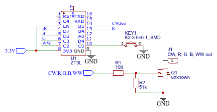
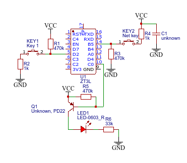

# Supported devices
Note, links to shops provided as reference only. I am not affiliated with these stores in any way. 

Also, be warned what Tuya names are completely unreliable. Tuya name, reported as Zigbee Model (ZCL attribute 0x0005 ModelIdentifier) is not a unique device name or model, but device class. For example, TS0501B is a light device single color, lots of completely diffrent devices can share same name. Tuya model name, reported as Zigbee Manufacturer (ZCL attribute 0x0004 ManufacturerName) too unique, and identical from hardware point of view devices can have different Id's.

## Light
| Name | Model | Photo | Zigbee Model | Zigbee Manufacturer | State | Links |
|------|-------|-------|--------------|---------------------|-------|-------|
| Led strip controller - one color | | | TS0501B | \_TZ3210\_9q49basr | Supported | [Aliexpress](https://www.aliexpress.com/item/1005004267226841.html) [Aliexpress2](https://www.aliexpress.com/item/1005005196855536.html) |

### Notes
From hardware point of view, all controllers (Single color/RGB/RGBW/RGBCW) the same, at least Single color (Tuya name TS0501B) and RGBW (Tuya name TS0504B), and differs only by firmware and external connector to LED strip. All controllers share same populated PCB and based on Tuya ZT3L module, which is based on Z2 chip - actually it is TeLink TLSR8258 (TLSR8258F1KAT32).

### Schematics
Light strip controllers TS050XB. Actually, part of schematics. I was lazy enough to trace 3.3 voltage converter :) 

### How to join
Long press on button, connected LED will blink

### Features and improvements
- Short press on hardware button can be used as On/Off switch
- Working reporting of switching with hardware button
- Have a Power on behavior
- No more annoying bug with light goes off shortly afetr turn on (I hope)
- OTA updates

### Tasks
- [x] zigbee2mqtt converter
- [x] save state and power on control
- [x] reporting
- [x] OTA
- [ ] OTA update from Tuya firmware
- [ ] Reset by turning power on/off 5 times
- [ ] Direct control of LED PWM

## Switch
| Name | Model | Photo | Zigbee Model | Zigbee Manufacturer | State | Links |
|------|-------|-------|--------------|---------------------|-------|-------|
| Lonsonho 1 gang switch | ZBWS01A (on case) | | TS0041 | \_TZ3000\_s0i14ubi | Supported | [Aliexpress](https://www.aliexpress.com/item/4001095272467.html) white, 1-gang |
| Lonsonho 2 gang switch | ZBWS02A (on case) | | TS0042 | \_TZ3000\_v8jvcwsx | WIP | [Aliexpress](https://www.aliexpress.com/item/4001095272467.html) white, 2-gang |
| Lonsonho 3 gang switch | ZBWS03A (on case) | | TS0043 | \_TZ3000\_uyjmm0et | WIP | [Aliexpress](https://www.aliexpress.com/item/4001095272467.html) white, 3-gang |

### Notes
All models use same PCB, different only populated components and mapping of keys and leds to GPIO pins. Some [notes about devices](switch-lonsonho.txt).

### Schematics

### How to join
Long press on Net Key button

### Button behavior

ZBWS01A has two buttons: **Net Key** and **SW1** (the main button).

| Action | Net Key | SW1 |
|---|---|---|
| Short click | Sends battery report; LED blinks once | Toggles bound lights; reports `single`; LED blinks once |
| Double click | No command; LED blinks twice | Steps brightness by 50 and reverses at the ends; reports `double`; LED blinks twice |
| Triple click | No command; LED blinks three times | Reports `triple` only; LED blinks three times |
| Long press | After 5 s: factory reset, leaves the network; LED blinks 300 ms on/off while pressed | After 3 s: starts a brightness move (direction alternates); reports `hold`; LED blinks fast. Release stops the move and reports `release` |

Click timing:

- A click is confirmed 250 ms after release so double/triple clicks can be detected; wait for the confirmation blinks.
- Presses shorter than 30 ms and presses within 50 ms after a release are ignored as bounce.
- SW1 single/double/long-press commands are sent to bound devices. Without a binding, the light commands do nothing, but the action report is still sent to the coordinator.
- Net Key multi-clicks are LED-only. Net Key long press is the factory reset.

LED feedback:

- Net Key press: 300 ms on / 300 ms off, starting immediately.
- SW1 long press: 100 ms on / 100 ms off.
- Click confirmation: one, two or three 250 ms on/off blinks, starting after the 250 ms detection window.
- SW1 has no LED while pressed before the long-press threshold.

### Features and improvements
- Binding
- Short press on button send toggle command (switch binded light on/off)
- Long press on button send move command, so light brightness a changed. Direction is switched on next press
- Double click on button steps brightness; triple click reports the action
- LED feedback for clicks and long presses
- Short press on Net Key button send report with battery status
- OTA updates
- OTA update from Tuya firmware

### Tasks
- [x] zigbee2mqtt converter
- [x] binding
- [x] reporting
- [x] OTA
- [x] OTA update from Tuya firmware
- [x] Multiclick support

## Intruder Alarm System (IAS)
| Name | Model | Photo | Zigbee Model | Zigbee Manufacturer | State | Links |
|------|-------|-------|--------------|---------------------|-------|-------|
| IHOMECAM Door sensor with lux | ZG-102ZL | | TS0601 | \_TZE200\_pay2byax | WIP | [Aliexpress](https://www.aliexpress.com/item/1005004988882583.html) With Lux 1pc |

### How to join
Long press on button, LED will constantly light for 5 seconds then blink

### Features and improvements
- Support for IAS Enroll
- Binding to On/Off cluster, door sensor can directly turn on or off lights or similar devices
- Configurable commands send to binded devices
- Configurable network polling intervals accordingly to ZCL POLL_CONTROL cluster
- Configurable battery and light sensor polling interval
- Short press on button send report with battery status
- OTA updates

### Tasks
- [x] zigbee2mqtt converter
- [x] binding
- [x] reporting
- [x] OTA
- [x] POLL_CONTROL
- [x] converter support for POLL_CONTROL
- [ ] battery and sensor poll interval
- [x] converter support for sensor poll control
- [ ] OTA update from Tuya firmware
- [ ] Light sensor values unreliable
